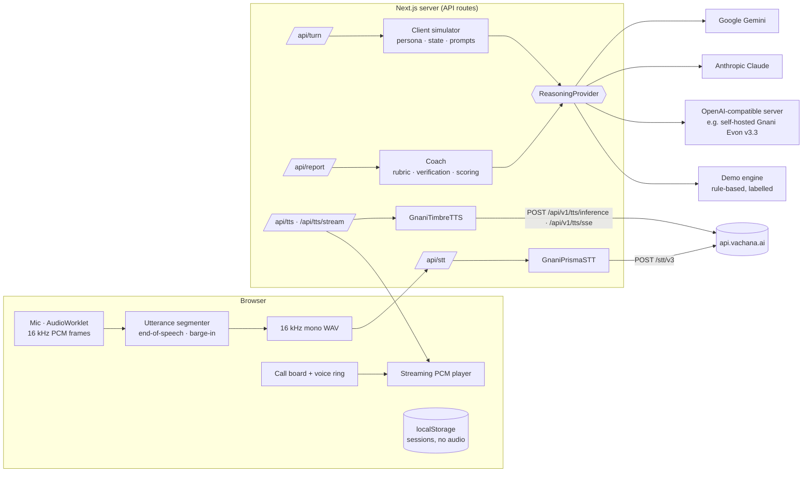

# ClientReady

**Practise difficult client conversations before the real call.** ClientReady is a voice role-play and coaching app for Indian freelancers selling to international clients. You speak to a realistic, fictional US/UK/Canadian/Australian client who pushes back on your price, scope and technology. Then you get a coaching report that quotes what you actually said and shows a stronger answer for *your* offer.

Built for the Great Indian AI Internship Challenge 2026 on **Gnani Prisma v2.5** (speech-to-text) and **Gnani Timbre** (text-to-speech).

> ClientReady coaches clarity, structure and substance. It never scores an Indian accent as a weakness.

---

## What works today

| Capability | Status |
|---|---|
| Landing page, guided scenario builder, 5 ready-made scenarios, pre-call briefing with mic check | ✅ |
| Hands-free voice call: mic → in-browser end-of-speech detection → **Gnani Prisma** → client reasoning → **Gnani Timbre** streamed over SSE, with barge-in, mute, captions and a 10-minute cap | ✅ server pieces verified live; mic capture needs a real browser (see *Verification status*) |
| Spoken coach debrief before the written report (Timbre coach voice, quote-checked) | ✅ verified live with Gemini + Timbre |
| Optikka-style UI: warm paper, Inter Tight, dotted rules, a voice ring that reacts to whoever is speaking | ✅ |
| Scripted sample call (`/practice/session?sample`) for demos without a mic or keys, labelled as a sample | ✅ |
| Adaptive client: persistent persona, hidden concerns revealed gradually, interest tracking, natural endings, turn limits | ✅ with an LLM provider; a simpler rule-based demo engine without one |
| Multilingual: speak in 10 Indian languages or Hinglish, English rendering for the client, coaching in your language | ✅ (needs an LLM provider for translation) |
| Coaching report: 9-category weighted scorecard, verified quotes, better answers, exercises, 3-step plan, language bridge, measured delivery | ✅ |
| "Listen" to a better answer through Timbre | ✅ |
| Session history with progress chart, per-session and bulk delete, Markdown / print export | ✅ (stored in the browser) |
| Typed-answer fallback when the mic or Prisma is unavailable (clearly marked as typed, never as Prisma output) | ✅ |

## Architecture



Each provider sits behind an interface in `src/lib/providers/types.ts` (`TranscriptionProvider`, `SynthesisProvider`, `ReasoningProvider`) and can be swapped on its own.

### Gnani models and APIs used

Everything below was checked against [docs.gnani.ai](https://docs.gnani.ai) on 22 Oct 2026.

| Model | Endpoint | How ClientReady uses it |
|---|---|---|
| **Gnani Prisma v2.5** (STT) | `POST https://api.vachana.ai/stt/v3` (multipart). Header `X-API-Key-ID`. Fields `audio_file`, `language_code`, `format=transcribe` (ITN, so prices come back as digits), `bias_list` + `bias_score` (boosts your product names) | Transcribes each learner answer. The browser converts MediaRecorder output (WebM/Opus or MP4, which Prisma's list doesn't cover reliably) into **16 kHz mono 16-bit PCM WAV**. Answers are capped at **30 s**: the REST page allows 60 s, but its OpenAPI spec says 30 s. |
| **Gnani Timbre v2.5** (TTS, default) | `POST https://api.vachana.ai/api/v1/tts/inference` (JSON). `model: "timbre-v2.5"`, `voice`, `language`, `speed`, `audio_config` (WAV, 24 kHz, mono, PCM16). Returns raw audio bytes. | Speaks the client's replies with an English (`en-IN`) voice: Kaveri, Devika or Trupti (female), Pranav, Girish or Shlok (male). It also plays suggested answers in the report. `timbre-v3.0` is supported via `GNANI_TTS_MODEL`, using its own voice catalog. |
| **Gnani Evon v3.3** (reasoning) | Open weights ([HF](https://huggingface.co/gnani/gnani-evon-v3.3-30B-A3B)). **Not on Gnani's API platform yet**, per the challenge page. | Optional. Serve it yourself with vLLM or SGLang and point `OPENAI_COMPAT_*` at it. The UI shows `OPENAI_COMPAT_LABEL`, so a different model is never presented as Evon. |

**Voices and accents:** Timbre's catalog contains Indian voices. ClientReady doesn't claim US or UK accents. The client's nationality is simulated through role, context and dialogue.

**Languages:** Prisma REST supports `bn-IN, en-IN, gu-IN, hi-IN, kn-IN, ml-IN, mr-IN, pa-IN, ta-IN, te-IN`. Its `en-IN` model accepts Hindi–English mixed speech and returns Latin script, which is how "Hinglish" speech is supported. Timbre also accepts `hi-en` (Hinglish).

### Reasoning provider

The provider is selected automatically: `ANTHROPIC_API_KEY` → Claude; otherwise `GEMINI_API_KEY` (or `GOOGLE_API_KEY`) → Gemini; otherwise `OPENAI_COMPAT_BASE_URL` + `OPENAI_COMPAT_MODEL` → that server; otherwise the **demo engine**. Set `REASONING_PROVIDER` to force one.

- **Gemini** uses the official `@google/genai` SDK `models.generateContent` with `responseMimeType: "application/json"` and `responseJsonSchema` (generated from the same Zod schemas, with nullable fields rewritten into Gemini's `["string","null"]` form). The output is then re-validated with Zod. The default model is `gemini-3.8-flash` for both the client and the coach. Client turns use `thinkingLevel: LOW`, which measured ~3.6 s per turn versus ~12 s at the model default, with the same quality of reply. Coaching reports keep the model's default thinking (~25 s per report). If a model rejects a thinking level, the call is retried once without it. Retries happen once, and only on 5xx errors. Quota (429), key (400/403) and unknown-model (404) errors get specific messages.
- **Claude** uses `@anthropic-ai/sdk` `beta.messages.parse` with Zod structured outputs, so every client turn and report is schema-validated JSON. The default model is `claude-opus-5-5`, with `effort: low` for client turns (latency) and `medium` for reports. Server-side refusal fallback (`fallbacks: "default"`) is on for models that support it.
- **OpenAI-compatible** uses JSON mode plus the JSON Schema in the prompt, then tolerant parsing and Zod validation.
- **Demo engine** is deterministic keyword rules. It's labelled "Demo engine (rule-based, not an LLM)" in the studio, the report and history. It exists so the full flow and the real Gnani voice pipeline can be shown without an LLM key. It cannot translate non-English speech.

## The call experience

The call screen follows the "Optikka" design brief: one board split by dotted rules into three columns and three rows, small uppercase labels, a large display line, and one orange phrase per screen.

1. **Ready.** "Meet Dr. Mitchell", the engines that are live, and Start the call. A user gesture starts the AudioContext and asks for the mic.
2. **Client opens.** `/api/turn` with an empty history. The reply is streamed from Timbre (`/api/tts/stream`, raw 16-bit PCM at 24 kHz over SSE) into a player whose level drives the ring.
3. **You answer, hands-free.** An AudioWorklet cuts the mic into 32 ms 16 kHz frames. `UtteranceSegmenter` tracks an adaptive noise floor and ends a segment after **1.1 s of quiet** (enough for a thinking pause). It keeps 320 ms of pre-roll and drops clicks under 0.3 s. Each segment goes to Prisma REST as WAV (≈0.3 s). Your answer is committed once you are quiet and every segment is transcribed. Long answers are cut at 28 s and transcribed in parts.
4. **No transcript during the call.** Captions are optional. They switch on automatically when you type or when Timbre is unavailable.
5. **Barge-in.** While the client talks, speaking clearly louder than the room for 350 ms stops the client and hands you the turn. The line is marked "interrupted" in the transcript.
6. **The call ends** when you press End call, when the client decides, declines or runs out of patience, or after 10 minutes. An answer you were still giving is transcribed and kept.
7. **Debrief.** `/api/report` returns the scorecard plus a spoken script. The coach voice (Trupti by default, or the coaching language's voice) reads it, starting with *"The conversation between you and the client has now ended. Here are the areas where you could have done better."* Each mistake segment follows *"In this part you said, '…'. Here's how to …"*. Segments whose quote can't be found in your transcript are dropped. Then the written report opens, and you can replay the debrief from it.

**Delivery evidence.** Prisma returns text only, so the coach may comment on tone only with measured evidence: pace, fillers and hedges (from the transcript), plus answer delay, mid-answer pauses, loudness variation and talk-time share (from the microphone during a live call). The report shows those numbers.

**Differences from the prototype (`clientready-call`)**

- *Realtime STT socket → in-browser segmentation + Prisma REST.* The prototype proxied Prisma's realtime WebSocket. Next.js route handlers can't upgrade WebSockets, and serverless hosts such as Vercel don't support them, so ClientReady detects end-of-speech in the browser instead. Prisma REST measured ≈0.3 s per segment live, so the turn-taking feels the same, and the app stays deployable anywhere.
- *Scoring.* The prototype scored six areas from 1 to 5. ClientReady keeps its research-anchored 9-category, 0–100 scorecard, which the history chart depends on. It adds the prototype's moments, delivery notes, proposal steps, next drill and spoken debrief.
- *LLM adapter.* The prototype's raw Anthropic/OpenAI adapter is replaced by the existing provider layer: Gemini, Claude or OpenAI-compatible, with schema-validated output.

## Run it locally

Requirements: Node 20+ (tested on Node 22).

```bash
npm install
cp .env.example .env.local    # add GNANI_API_KEY, plus GEMINI_API_KEY (or ANTHROPIC_API_KEY / an OpenAI-compatible server)
npm run dev                   # http://localhost:3000
```

Without any keys the app runs in demo mode: typed answers, text-only client, rule-based coach, all clearly labelled.

### Environment variables

See [`.env.example`](.env.example). All are server-side only. `/api/status` exposes booleans and labels, never values.

| Variable | Purpose |
|---|---|
| `GNANI_API_KEY` | Prisma and Timbre. Create one at [app.gnani.ai/voice](https://app.gnani.ai/voice). |
| `GNANI_TTS_MODEL` | `timbre-v2.5` (default) or `timbre-v3.0` |
| `GEMINI_API_KEY` (or `GOOGLE_API_KEY`), `GEMINI_CLIENT_MODEL`, `GEMINI_COACH_MODEL`, `GEMINI_CLIENT_THINKING_LEVEL`, `GEMINI_COACH_THINKING_LEVEL` | Gemini reasoning. Get a key at [aistudio.google.com/apikey](https://aistudio.google.com/apikey). |
| `ANTHROPIC_API_KEY`, `ANTHROPIC_CLIENT_MODEL`, `ANTHROPIC_COACH_MODEL` | Claude reasoning |
| `OPENAI_COMPAT_BASE_URL`, `OPENAI_COMPAT_MODEL`, `OPENAI_COMPAT_API_KEY`, `OPENAI_COMPAT_LABEL` | Self-hosted Evon or another compatible server |
| `REASONING_PROVIDER` | Force `anthropic`, `gemini`, `openai-compatible` or `demo` |
| `RATE_LIMIT_PER_MINUTE` | Per-IP, per-endpoint limit (default 30) |

## Tests

```bash
npm test                    # 159 unit tests, all providers mocked, no network
npm run test:integration    # REAL Gnani calls: Timbre→Prisma round trip in English, Hindi, Hinglish (skipped without GNANI_API_KEY)
npm run smoke               # full pipeline: Timbre learner line → Prisma → reasoning → Timbre reply; writes WAVs to tmp/smoke/ (reasoning-only check if GNANI_API_KEY is missing)
npm run typecheck && npm run lint && npm run build
```

The unit tests cover scenario validation and defaults, persona determinism, state transitions, duplicate-turn protection, prompt-injection neutralisation, structured-output parsing and malformed model output, quote verification, weighted scoring, delivery metrics, WAV encoding and validation (empty, silent, too long, stereo, wrong format), Gnani request shapes, error mapping, retries and timeouts, rate limiting, idempotency, API routes with and without credentials, session history, safe rendering of hostile model text, and a full demo user journey for every preset.

The integration test caches Timbre output in `tests/fixtures/`, so repeat runs only spend Prisma credits.

## Verification status

Live results from 22 Oct 2026 (Gnani + Gemini keys):

- ✅ `npm run smoke`: Timbre (1.0 s) → Prisma (0.3 s, accurate transcript) → Gemini client turn (~3.5 s) → Timbre reply (1.5 s). A full turn takes about 5 s.
- ✅ `npm run test:integration`: Timbre → Prisma round trips in **English, Hindi (Devanagari) and Hinglish** are transcribed correctly, and an invalid key returns a clean auth error.
- ✅ Through the running app's API routes: Gemini opening and replies are context-aware (they raise hidden concerns such as AI accuracy and ROI), Timbre `/api/tts` returns WAV with voice Kaveri, and the Gemini coaching report comes back in ~25–33 s with every quote verified (0 dropped), specific issues and better answers.
- ✅ A real browser session with microphone input completed: `/api/stt` (Prisma) → `/api/turn` → `/api/tts` → `/api/report`.
- ✅ 159 unit tests, typecheck, lint and production build pass.
- ✅ Call screen redesign (28 Oct), verified live in the browser with Gemini + Timbre: the client opening and two Gemini replies, streamed Timbre audio (`/api/tts/stream`: start → 125 chunks → complete, 24 kHz PCM, coach voice Trupti), the spoken debrief (5 segments, exact opening line, quotes verified) and the redesigned report. The scripted sample call was also played through to its report.
- ⚠️ Hands-free microphone capture (AudioWorklet → segmenter → Prisma) wasn't exercised in automation, because the test browser blocks the mic. The segmenter, barge-in and timing logic are unit-tested with synthetic audio, and Prisma REST was verified live. Try one real call with headphones before recording your demo.
- Tuning found during live testing: Gemini client turns took 7–12 s at the model's default thinking. `thinkingLevel: LOW` brought them to ~3.5 s with no visible drop in quality. Gemini once stalled for 45 s on an opening that normally takes 3 s, so client turns now time out at 20 s and retry once.

## Deploy (Vercel)

1. Push to GitHub and import the repo in Vercel (framework: Next.js, no extra config).
2. Add `GNANI_API_KEY` and one of `GEMINI_API_KEY`, `ANTHROPIC_API_KEY` or `OPENAI_COMPAT_*` under Project → Settings → Environment Variables.
3. Deploy. API routes run on the Node.js runtime with `maxDuration` of 60 s (`/api/report`: 120 s; Hobby plans cap lower, so use a fast coach model there).

Any Node host works: `npm run build && npm start`. The microphone requires **HTTPS** (or `localhost`).

## Security, privacy and cost controls

- Keys are read only in `src/lib/server/env.ts` and the provider classes (`server-only`). They are never logged or sent to the browser.
- All inputs are Zod-validated on the server, with bounded field lengths, ≤ 50 turns, ≤ 1,500 characters per turn, ≤ 30 s per recording, and ≤ 900 characters per TTS request.
- Prompt injection: scenario fields and learner speech go into prompts as DATA blocks with delimiters neutralised. The system rules explicitly outrank them.
- Silent, empty, too-long or malformed audio is rejected **before** spending Prisma credits.
- Retries are bounded (max 2–3 attempts, only for 5xx and network errors). Duplicate submissions of the same turn return the cached reply (idempotency key), so the client is never generated twice.
- In-memory per-IP rate limiting on every API route.
- Audio is held in memory for the request only and never stored. History lives in `localStorage` and can be deleted per session or all at once.
- Friendly, specific errors cover a missing key, a rejected key, exhausted credits or access (Gnani 403), rate limits, timeouts and empty transcripts.

## 60-second demo script

Use headphones, so the client's voice doesn't trigger barge-in.

1. **(0–8 s)** Landing page → "Start practising" → **AI receptionist for a US dental clinic** → briefing (engine panel: Prisma, Timbre and Gemini all live) → "Go to the call".
2. **(8–15 s)** "Start the call". The ring turns grey and moves with Dr. Mitchell's Timbre voice as she explains the missed calls.
3. **(15–30 s)** Answer weakly on purpose: *"Our AI receptionist answers calls 24/7 and integrates with your calendar."* Stop talking; after a beat she pushes back: *"That's a list of features. How do I know it brings in patients?"*
4. **(30–42 s)** Talk over her to show barge-in, then answer better, in Hinglish if you like. Propose a two-week pilot. End the call.
5. **(42–60 s)** The coach's voice: *"In this part you said, '…'. Here's how to…"*. Skip to the report: the score, the verified quote, the stronger line for this clinic and price, and **Listen (Gnani Timbre)**.

No mic or keys? `/practice/session?sample` plays a scripted, clearly labelled sample of the same flow.

## Known limitations

- End-of-speech detection is an energy-based heuristic. A very noisy room can delay the end of a turn, and loud speakers without headphones can trigger barge-in. Raise `multiplier` in `BargeInDetector` if that happens.
- Latency per turn is roughly 1.1 s of silence + Prisma (≈0.3 s) + Gemini (≈3.5 s) + the first Timbre audio. Prisma's realtime WebSocket would trim a little more, but needs a host that supports WebSockets.
- The Gemini coaching report with the spoken script takes 30–60 s. Set `GEMINI_COACH_THINKING_LEVEL=LOW` to trade some depth for speed.
- The voice ring and the streaming player need Web Audio (AudioWorklet): current Chrome, Edge, Safari or Firefox.
- Rate limiting and idempotency are per server instance (in-memory).
- History is per browser. There are no accounts.
- The demo engine is intentionally simple and can't translate. Use an LLM provider for real practice.
- Delivery metrics come from duration and transcripts only. There is no acoustic analysis of stress or intonation.

## Troubleshooting

| Symptom | Fix |
|---|---|
| "Gnani Prisma is not configured" | Add `GNANI_API_KEY` to `.env.local` and restart `npm run dev`. |
| "Gnani … refused access" (403) | Check the key, organisation status and remaining credits at app.gnani.ai/voice. |
| Mic blocked | Allow the microphone in site settings. It must be HTTPS or localhost. You can always type instead. |
| "We couldn't hear anything" | The mic is muted or too quiet. The clip is rejected before any credits are spent. |
| No client audio | Turn on Captions. If Timbre isn't configured, captions turn on automatically. |
| The client keeps getting interrupted | Use headphones. The client's voice from your speakers is being heard as you talking. |
| Your turn never ends | The room is noisy: pause a little longer, or use Mute and the typed fallback. |

## Project layout

```
src/app/                 pages (landing, practice, briefing, session, report, history) + API routes
src/lib/providers/       gnani/{prisma,timbre,voices}.ts, reasoning/{anthropic,openai-compatible,demo}.ts
src/lib/sim/             persona, prompts, state machine, engine
src/lib/coach/           rubric, scoring, metrics, report verification, prompts, markdown export
src/lib/audio/           WAV encode/parse/validate
src/lib/client/          API client, localStorage history, voice/ (ring, audio worklet + PCM player, live call and sample call engines)
src/lib/voice/           utterance segmenter, barge-in detector, voice-timing tracker, SSE parser (pure, unit-tested)
src/lib/sample/          the scripted sample call and its report
tests/unit, tests/integration, scripts/gnani-smoke.ts, docs/COACHING_FRAMEWORK.md
```

All scenarios, clients and businesses are fictional. Use synthetic data only.
